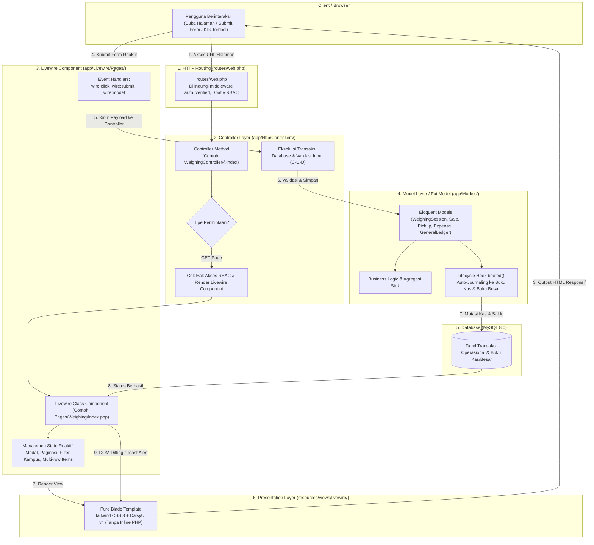

# ♻️ Sistem Pengelolaan Sampah Kampus (PS2 UAD)
> **Sistem Informasi Manajemen Pengelolaan Sampah Multi-Kampus & Survei KAP (Knowledge, Attitude, Practice, and Satisfaction)**  
> **Universitas Ahmad Dahlan (UAD) — Mengacu Spesifikasi SRS v2 Resmi**

[](https://laravel.com)
[](https://php.net)
[](https://livewire.laravel.com)
[](https://tailwindcss.com)
[](https://daisyui.com)
[](https://www.docker.com/)

---

## 📑 Daftar Isi (Table of Contents)
1. [🚀 Cara Menjalankan Aplikasi di Lokal (Pilihan Metode)](#-cara-menjalankan-aplikasi-di-lokal-pilihan-metode)
   - [Opsi A: Native Windows (Laragon / XAMPP) — Direkomendasikan](#-opsi-a-native-windows-laragon--xampp--rekomendasi-utama)
   - [Opsi B: Docker Compose (Container)](#-opsi-b-docker-compose-kontainer)
2. [🏛️ Arsitektur Kode: Pure MVC + Livewire 3](#-arsitektur-kode-pure-mvc--livewire-3-alur-dari-mana-ke-mana)
   - [1. Diagram Alur Request & Data Flow](#1-diagram-alur-request--data-flow)
   - [2. Penjelasan Peran Layer ("Dari Mana ke Mana")](#2-penjelasan-peran-masing-masing-layer-dari-mana-ke-mana)
   - [3. Simulasi Transaksi Nyata (M2 Penimbangan)](#3-contoh-alur-nyata-pencatatan-penimbangan-sampah-m2)
3. [📌 Ringkasan & Konsep Bisnis Sistem](#-ringkasan-proyek--alur-bisnis-srs-v2)
4. [🧩 Modul & Fitur Sistem (SRS M1 – M11)](#-modul--fitur-sistem-srs-m1--m11)
5. [🔑 Akun Pengguna Bawaan Seeder](#-akun-demo-bawaan-seeder)
6. [🧪 Pengujian Otomatis (E2E Tests)](#-pengujian-otomatis-e2e-verification)
7. [📖 File Dokumentasi Lengkap](#-file-dokumentasi-terkait)

---

## 🚀 Cara Menjalankan Aplikasi di Lokal (Pilihan Metode)

Untuk mempermudah setup di komputer Anda, panduan instalasi telah dipisahkan ke dalam **file dokumentasi mandiri**. Silakan klik tombol di bawah sesuai metode yang ingin Anda gunakan:

### 👇 PILIH SALAH SATU CARA BERIKUT:

[-KLIK_DI_SINI_UNTUK_PANDUAN_LENGKAP-2ea44f?style=for-the-badge&logo=windows&logoColor=white)](./LOCAL_SETUP.md)

[-KLIK_DI_SINI_UNTUK_PANDUAN_LENGKAP-0078D4?style=for-the-badge&logo=docker&logoColor=white)](./DOCKER_SETUP.md)

---

### 📊 Perbandingan Cepat Kedua Metode

| Parameter | ⚡ Opsi A: Native Windows (Laragon / XAMPP) | 🐳 Opsi B: Docker Compose |
| :--- | :--- | :--- |
| **File Panduan** | [**`LOCAL_SETUP.md`**](./LOCAL_SETUP.md) *(Klik untuk buka)* | [**`DOCKER_SETUP.md`**](./DOCKER_SETUP.md) *(Klik untuk buka)* |
| **Rekomendasi** | ⭐⭐⭐ **Sangat Direkomendasikan untuk Windows** | Cocok untuk Linux, VPS, atau pengguna Docker |
| **Kelebihan** | Super ringan, bebas beban RAM WSL2, minim error | Lingkungan seragam dan terisolasi |
| **Potensi Kendala** | Perlu install PHP, Composer, Node & MySQL terpisah | Docker engine mati, CRLF bash error, bentrok port |
| **Koneksi DB (.env)** | `DB_HOST=127.0.0.1` | `DB_HOST=db` |

---

### ⚡ Opsi A: Native Windows (Laragon / XAMPP) — *Rekomendasi Utama*
> Panduan lengkap langkah demi langkah: 👉 [**Baca Selengkapnya di LOCAL_SETUP.md**](./LOCAL_SETUP.md)

**Ringkasan Perintah Cepat:**
```powershell
# 1. Salin file konfigurasi .env
copy .env.example .env

# 2. Sesuaikan .env Anda: DB_HOST=127.0.0.1, DB_DATABASE=ps2_uad, DB_USERNAME=root, DB_PASSWORD=

# 3. Install paket backend & buat key
composer install
php artisan key:generate

# 4. Migrasi seluruh tabel SRS v2 & isi data awal seeder
php artisan migrate:fresh --seed

# 5. Build file frontend
npm install
npm run build

# 6. Buat storage link & jalankan server
php artisan storage:link
php artisan serve
```
Buka browser di: **`http://127.0.0.1:8000`** *(Login: `superadmin@uad.ac.id` / `password123`)*

---

### 🐳 Opsi B: Docker Compose (Kontainer)
> Panduan lengkap & troubleshooting: 👉 [**Baca Selengkapnya di DOCKER_SETUP.md**](./DOCKER_SETUP.md)

> [!WARNING]
> **Kenapa `docker compose up` langsung sering gagal di Windows?**
> 1. Docker Desktop belum berjalan.
> 2. File script `docker/php/entrypoint.sh` berformat Windows CRLF (`$'\r': command not found`).
> 3. Port `8000`, `3307`, atau `5173` bentrok dengan aplikasi lokal lain.
> 4. Database belum di-seed sehingga user demo belum ada.

**Ringkasan Perintah Cepat Docker (Setelah Docker Desktop Aktif):**
```powershell
# 1. Salin konfigurasi .env (DB_HOST=db)
copy .env.example .env

# 2. Normalisasi baris script bash Windows CRLF -> LF
(Get-Content -Raw docker/php/entrypoint.sh) -replace "`r`n", "`n" | Set-Content -NoNewline docker/php/entrypoint.sh

# 3. Build & jalankan seluruh kontainer
docker compose up -d --build

# 4. Jalankan seeder database
docker compose exec app php artisan db:seed
```
Buka browser di: **`http://localhost:8000`** | Dozzle Logs: **`http://localhost:8888`**

---

## 🏛️ Arsitektur Kode: Pure MVC + Livewire 3 (Alur Dari Mana ke Mana)

Aplikasi **PS2 UAD** menerapkan standar arsitektur **Pure MVC (Model-View-Controller)** yang dipadukan dengan kemampuan reaktif **Livewire 3 (Class-Based Component)**. Arsitektur ini meniadakan logika inline Volt dan menolak fragmentasi berlebihan (tanpa folder *Services* atau *Observers* terpisah), melainkan berpegang pada filosofi **Fat Model, Skinny Controller**.

---

### 1. Diagram Alur Request & Data Flow



---

### 2. Penjelasan Peran Masing-Masing Layer ("Dari Mana ke Mana")

| Layer | Letak Direktori | Peran & Tanggung Jawab Utama |
| :--- | :--- | :--- |
| **1. Route** | `routes/web.php` | **Pintu Gerbang Utama:** Menerima permintaan HTTP dari browser, menyaring dengan middleware otentikasi (`auth`, `verified`), dan mendelegasikan rute ke Controller yang bersangkutan (tidak ada route view langsung). |
| **2. Controller** | `app/Http/Controllers/` | **Gatekeeper & Transaction Engine:** Memeriksa permission pengguna (Spatie RBAC), memanggil instance komponen Livewire (`app(Component::class)()`), memvalidasi input data dengan `Validator`, dan mengeksekusi operasi transaksi C-U-D (Create-Update-Delete) ke database. |
| **3. Livewire Component** | `app/Livewire/Pages/`<br/>`app/Livewire/Layout/` | **Reactive UI State Manager:** Mengelola state reaktif antarmuka di sisi server (buka/tutup modal dialog, filter kampus, paginasi dinamis, form bertingkat) tanpa reload halaman dan tanpa penulisan JavaScript kustom. |
| **4. Model (Fat Model)** | `app/Models/` | **Pusat Logika Bisnis & Integritas Data:** Menangani agregasi stok (`getAvailableStock`), rekonsiliasi buku besar harian (`recalculateLedgerFromDate`), serta otomatisasi pencatatan jurnal keuangan via model lifecycle hook `booted()` (`Sale::booted()`, `Pickup::booted()`, `Expense::booted()`). |
| **5. Blade View** | `resources/views/livewire/`<br/>`resources/views/layouts/` | **Lapisan Presentasi Bersih:** Template Blade murni tanpa script logika PHP rumit (`@volt` ditiadakan), dihias dengan Tailwind CSS 3 dan DaisyUI v4 untuk antarmuka yang modern, bersih, dan ramah seluler. |

---

### 3. Contoh Alur Nyata: Pencatatan Penimbangan Sampah (M2)

1. **Akses Modul:** Pengguna mengklik menu *"Penimbangan"*, browser mengirim `GET /weighing`.
2. **Routing:** `routes/web.php` meneruskan ke `WeighingController::class, 'index'`.
3. **Pemeriksaan Izin:** `WeighingController@index` memastikan role memiliki hak `weighing.view`, lalu merender `app(WeighingComponent::class)()`.
4. **Persiapan State:** Komponen `app/Livewire/Pages/Weighing/Index.php` mengambil data master jenis sampah dan sumber dari Model, lalu menampilkan `resources/views/livewire/pages/weighing/index.blade.php`.
5. **Aksi Pengguna:** Pengguna mengisi formulir bobot timbang lalu menekan tombol *Simpan* (`wire:submit="saveWeighing"`).
6. **Eksekusi Transaksi:** Method `saveWeighing()` di Livewire mengoper data ke `WeighingController@store` untuk validasi `Validator::make` dan penyimpanan ke database melalui model `WeighingSession` & `WeighingItem`.
7. **Pembaruan Reaktif:** Livewire menutup modal, mereset formulir, dan memunculkan pop-up toast berhasil tanpa refresh halaman penuh.

---

## 📌 Ringkasan Proyek & Alur Bisnis (SRS v2)

1. **Multi-Kampus & Scoping:**
   - Mencakup unit TPS di Kampus 1 sampai Kampus 6 UAD.
   - Petugas dan admin terikat ke unit kampus masing-masing (`campus_id`) secara otomatis, sedangkan **Super Admin** dapat mengelola agregat seluruh kampus secara menyeluruh.
2. **Akumulasi Stok (Bukan Sekadar Riwayat):**
   - Sampah ditimbang harian dan terakumulasi sebagai stok di TPS.
   - **Stok Sampah Terpilah (`is_sellable = true`)** = `Total Timbang - Total Terjual`.
   - **Akumulasi Residu (`is_sellable = false`)** = `Total Timbang Residu - Total Diangkut Vendor`.
3. **Model Keuangan v2: Buku Kas & Buku Besar Eksplisit:**
   - **Buku Kas (Tabel `keuangan`)**: Jurnal setiap mutasi keuangan:
     - **Kredit (K / Pemasukan)**: Otomatis tercatat saat **Penjualan Sampah (M3)** disimpan via `Sale::booted()`.
     - **Debet (D / Pengeluaran)**: Otomatis tercatat saat **Pengangkutan Residu (M4)** disimpan via `Pickup::booted()` (`volume × tarif`), serta dari **Pengeluaran Operasional (M5)** via `Expense::booted()`.
   - **Buku Besar (Tabel `buku_besar`)**: Menyimpan saldo harian per unit kampus:
     $$\text{Saldo Akhir} = \text{Saldo Awal} + \text{Total Kredit} - \text{Total Debet}$$
     Saldo akhir hari $X$ otomatis menjadi saldo awal hari $X+1$. Terjamin *auditable* dan jejak saldo dapat ditelusuri per transaksi.

---

## 🧩 Modul & Fitur Sistem (SRS M1 – M11)

- **M1 — Dashboard Monitoring:** KPI total timbangan (kg), volume (m³), akumulasi stok daur ulang & residu, saldo kas aktif, serta grafik komposisi timbulan sampah per kampus.
- **M2 — Penimbangan Harian:** Pencatatan hasil timbangan dari sumber titik sampah dengan 9 kategori granular (*Organik, Sampah Taman, Kardus, Karton, HVS, Plastik Keras, Plastik Multilayer, Logam/Kaca, Residu*).
- **M3 — Penjualan Sampah:** Penjualan sampah bernilai ekonomi ke pembeli/pengepul dengan validasi stok tersedia dan otomatisasi pencatatan Kredit di buku kas.
- **M4 — Pengangkutan Residu:** Pencatatan residu yang dibawa vendor pengolah, kalkulasi biaya otomatis berdasarkan tarif kontrak, dan pencatatan Debet di buku kas.
- **M5 — Pengeluaran Operasional:** Pencatatan belanja logistik TPS (karung, konsumsi pekerja, pakan ternak/maggot, alat kerja) dan jurnal Debet otomatis.
- **M6 — Buku Kas & Buku Besar:** Tab mutasi jurnal keuangan (K/D) serta tab neraca saldo harian buku besar per kampus UAD.
- **M7 — Master Data:** Pengelolaan titik sumber sampah, 9 jenis sampah, master vendor pengangkut + tarif, pembeli, dan kategori pengeluaran.
- **M8 — Laporan & Ekspor:** Rekapitulasi laporan operasional dan neraca keuangan dengan ekspor dokumen **Excel (.xlsx)** dan **PDF**.
- **M9 — Manajemen Pengguna & Hak Akses (Spatie RBAC):** 6 peran pengguna (*Super Admin, Koordinator TPS3R, Operator Timbangan, Pengurus Bank Sampah, Petugas Keuangan, Auditor/Pimpinan*).
- **M10 — Notifikasi & Alerts:** Notifikasi header dengan floating bell untuk pengingat input harian, alert stok menumpuk, alert saldo menipis, dan alert residu tinggi.
- **M11 — Modul & Dashboard Survei KAP:** Kuesioner publik responsif mobile (`/survei-kap`) untuk mengukur Knowledge, Attitude, Practice, & Satisfaction civitas kampus beserta dashboard analitik skoring indeks.

---

## 🔑 Akun Demo Bawaan Seeder

Semua akun demo menggunakan password bawaan yang seragam: **`password123`**

| Role Pengguna | Alamat Email | Unit Kampus | Hak Akses Utama |
| :--- | :--- | :--- | :--- |
| **Super Admin** | `superadmin@uad.ac.id` | Global (Semua Kampus) | Akses Penuh ke Seluruh Modul & Konfigurasi |
| **Operator Timbangan** | `operator@uad.ac.id` | Kampus 4 UAD (Utama) | Input Penimbangan Harian & Residu |
| **Koordinator TPS3R** | `koordinator@uad.ac.id` | Kampus 4 UAD (Utama) | Manajemen Operasional & Laporan Kampus 4 |
| **Pengurus Bank Sampah** | `banksampah@uad.ac.id` | Kampus 4 UAD (Utama) | Input Transaksi Penjualan Daur Ulang |
| **Petugas Keuangan** | `keuangan@uad.ac.id` | Kampus 4 UAD (Utama) | Biaya Operasional, Buku Kas, Buku Besar |
| **Auditor / Pimpinan** | `pimpinan@uad.ac.id` | Global (Semua Kampus) | Monitoring Read-Only Seluruh Modul & Laporan |

---

## 🧪 Pengujian Otomatis (E2E Verification)

Aplikasi dilengkapi suite pengujian otomatis Python untuk memvalidasi seluruh rute, RPC Livewire, 6 tab laporan, alur kuesioner KAP, dan keselarasan SRS:

```bash
# Verifikasi keselarasan seluruh modul SRS v2
python tests/e2e/test_srs_alignment.py

# Verifikasi aksesibilitas seluruh halaman antarmuka
python tests/e2e/verify_all_pages.py

# Verifikasi integrasi Pure MVC & Livewire
python tests/e2e/test_all_mvc.py
```
Panduan detail pengujian dapat dilihat di: **[`tests/e2e/README.md`](./tests/e2e/README.md)**.

---

## 📖 File Dokumentasi Terkait

* ⚡ **[`LOCAL_SETUP.md`](./LOCAL_SETUP.md)** — Panduan instalasi native di Windows (Laragon/XAMPP).
* 🐳 **[`DOCKER_SETUP.md`](./DOCKER_SETUP.md)** — Panduan instalasi kontainer Docker & penyelesaian kendala Docker.
* 🗺️ **[`DEVELOPMENT_JOURNEY.md`](./DEVELOPMENT_JOURNEY.md)** — Catatan riwayat fase pengembangan dan changelog sistem.
* 🧪 **[`tests/e2e/README.md`](./tests/e2e/README.md)** — Dokumentasi suite pengujian otomatis E2E.
