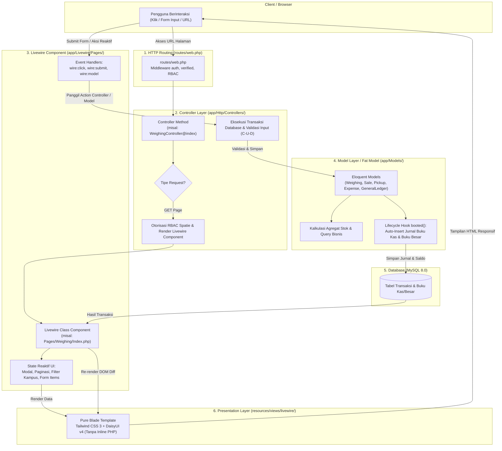

# ♻️ Sistem Pengelolaan Sampah Kampus (PS2 UAD)
> **Sistem Informasi Manajemen Pengelolaan Sampah Multi-Kampus & Survei KAP (Knowledge, Attitude, Practice, and Satisfaction)**
> **Universitas Ahmad Dahlan (UAD)**

[](https://laravel.com)
[](https://php.net)
[](https://livewire.laravel.com)
[](https://tailwindcss.com)
[](https://daisyui.com)
[](https://www.docker.com/)

---

## 📌 Ringkasan Proyek

**PS2 UAD** adalah sistem informasi komprehensif yang dirancang untuk mengelola rantai pemilahan, penimbangan, penjualan sampah terpilah, pengangkutan residu, hingga pencatatan keuangan operasional TPS (Tempat Penampungan Sementara) berbasis **Multi-Kampus (Kampus 1–6 UAD)**. 

Sistem ini dikembangkan mengacu pada spesifikasi resmi **`PS2 SRS New.pdf` (Analisis Kebutuhan v2)** dengan model buku kas & buku besar ganda serta modul survei perilaku civitas kampus (**Survei KAP**).

---

## 🏗️ Alur Bisnis & Konsep Utama (SRS v2 Aligned)

1. **Multi-Kampus & Scoping:**
   - Sistem mencakup unit TPS di Kampus 1 sampai Kampus 6 UAD.
   - Setiap pengguna/petugas terikat ke kampus masing-masing (`campus_id`) dengan global scope otomatis, sedangkan **Super Admin** dapat mengelola agregat seluruh kampus.
2. **Akumulasi Stok (Bukan Sekadar Riwayat):**
   - Sampah ditimbang harian dan terakumulasi sebagai stok di TPS.
   - **Stok Sampah Terpilah (`is_sellable = true`)** = `Total Timbang - Total Terjual`.
   - **Akumulasi Residu (`is_sellable = false`)** = `Total Timbang Residu - Total Diangkut Vendor`.
3. **Model Keuangan v2: Buku Kas & Buku Besar Eksplisit:**
   - **Buku Kas (Tabel `keuangan`)**: Jurnal setiap mutasi keuangan dengan status:
     - **Kredit (K / Pemasukan)**: Otomatis tercatat saat **Penjualan Sampah (M3)** disimpan via lifecycle event `Sale::booted()`.
     - **Debet (D / Pengeluaran)**: Otomatis tercatat saat **Pengangkutan Residu (M4)** disimpan via `Pickup::booted()` (`volume × tarif vendor`), serta dari **Pengeluaran Operasional (M5)** via `Expense::booted()`.
   - **Buku Besar (Tabel `buku_besar`)**: Menyimpan saldo harian per kampus:
     $$\text{Saldo Akhir} = \text{Saldo Awal} + \text{Total Kredit} - \text{Total Debet}$$
     Saldo akhir hari $X$ otomatis menjadi saldo awal hari $X+1$. Terjamin *auditable* dan jejak saldo dapat ditelusuri per transaksi tanpa perantara service terpisah.

---

## 🧩 Modul & Fitur Sistem (SRS M1 – M11)

- **M1 — Dashboard Monitoring:**
  - Selector kampus di topbar/sidebar. KPI: Total berat (kg), volume (m³), stok akumulasi, dan saldo kas kampus (dari record saldo akhir buku besar).
  - Grafik komposisi & tren timbulan per titik sumber.
- **M2 — Penimbangan Harian:**
  - Pencatatan hasil timbang dari sumber sampah (Area Taman, Kantin, Asrama, Gedung Rektorat, dll.).
  - 9 Kategori granular: *Organik Sisa Makanan, Sampah Taman, Kardus, Karton/Duplex, Kertas HVS, Plastik Keras, Plastik Multilayer, Logam & Kaca, Residu Campur*.
- **M3 — Penjualan Sampah:**
  - Penjualan sampah terpilah ke pembeli/pengepul (otomatis memvalidasi batas stok & auto-insert jurnal Kredit ke buku kas).
- **M4 — Pengangkutan Residu:**
  - Pencatatan residu yang diangkut vendor pengolah, kalkulasi biaya otomatis (`kg × tarif`), dan auto-insert jurnal Debet ke buku kas.
- **M5 — Pengeluaran Operasional:**
  - Biaya non-angkut (pembelian karung/bagor, pakan ternak/maggot, upah pilah, konsumsi tenaga kerja, alat TPS, obat P3K) dan auto-insert jurnal Debet.
- **M6 — Buku Kas & Buku Besar (MAJOR v2):**
  - **Tab 1 Buku Kas**: Jurnal mutasi keuangan K/D, nominal, saldo running, filter periode & sumber.
  - **Tab 2 Buku Besar**: Tabel saldo harian per kampus (Saldo Awal, Kredit (+), Debet (-), Saldo Akhir).
  - Header KPI: Total Kredit, Total Debet, Saldo Akhir, dan Total Transaksi.
- **M7 — Master Data:**
  - Manajemen terpadu: Titik Sumber Sampah per Kampus, 9 Jenis Sampah, Vendor Pengangkut + Tarif, Pembeli/Pengepul, dan Kategori Pengeluaran.
- **M8 — Laporan & Ekspor:**
  - Rekapitulasi timbang, angkut, penjualan, buku kas, dan buku besar dalam format **Excel (.xlsx)** dan **PDF**.
- **M9 — Manajemen Pengguna & Hak Akses (Spatie RBAC):**
  - **Super Admin**: Akses penuh ke seluruh modul, seluruh unit kampus, master data global, dan manajemen pengguna.
  - **Admin Kampus / Koordinator TPS3R**: Mengelola operasional timbang, penjualan, residu, keuangan, kas, laporan, dan staf kampusnya (terisolasi di unit kampus masing-masing).
  - **Petugas TPS / Operator Penimbangan**: Input timbangan harian dan pengangkutan residu (hanya operasional lapangan).
  - **Petugas Penjualan / Pengurus Bank Sampah**: Input transaksi penjualan sampah terpilah ke pengepul.
  - **Petugas Keuangan**: Input pengeluaran operasional, monitoring buku kas & buku besar, serta laporan keuangan.
  - **Auditor / Pimpinan (Viewer)**: Akses analitik komparatif antar kampus, laporan, dan monitoring read-only tanpa hak manipulasi data.
- **M10 — Notifikasi & Alerts:**
  - Floating bell notification di header dengan dropdown 3 notifikasi ringkas terbaru dan tautan ke halaman riwayat notifikasi terpadu (`/notifications`).
  - Reminder input harian, alert stok menumpuk, alert saldo menipis, dan alert residu tinggi.
- **M11 — Modul & Dashboard Survei KAP:**
  - Kuesioner publik responsif mobile via link/QR Code (`/survei-kap`) mencakup 4 dimensi: Demografi, Knowledge, Attitude, Practice, dan Satisfaction.
  - Skoring indeks otomatis (0–100%) dan dashboard analitik internal (`/kap`) dengan visualisasi komparatif antar kampus UAD.

---

## 🎨 Desain Antarmuka (Dribbble Clean Style)

* **Layout:** Sidebar navigasi kiri fixed setinggi layar (`h-screen overflow-hidden`) dengan badge unit kampus aktif, menu terorganisir per peran, dan konten utama yang dapat di-scroll mandiri.
* **Palette:** Sage Green (`#3a9d6e`), Sky Blue (`#3b82f6`), Amber (`#e5a520`), Coral (`#ef6b4a`), background bersih `#f5f7fa`.
* **Typography:** **DM Sans** untuk elemen UI dan **JetBrains Mono** untuk angka keuangan & bobot timbangan.

---

## 🛠️ Tech Stack & Arsitektur

* **Backend:** Laravel 12.x (PHP 8.3)
* **Frontend:** Blade + Livewire 3 (Pure MVC Class-based) + Alpine.js
* **CSS & UI:** Tailwind CSS 3 + DaisyUI v4
* **Database:** MySQL 8.0
* **Log Viewer:** Dozzle
* **Export:** DomPDF + CSV/Excel Stream
* **Auth & Permission:** Laravel Breeze + Spatie Laravel Permission
* **Containerization:** Docker Compose (`ps2-app`, `ps2-web`, `ps2-db`, `ps2-vite`, `ps2-dozzle`)
* **CI/CD:** GitHub Actions dengan Self-Hosted Runner ke VPS Oracle (`https://ps2.brotherzhafif.my.id`)

---

## 🏛️ Arsitektur Kode: Pure MVC + Livewire 3 (Alur Dari Mana ke Mana)

Aplikasi **PS2 UAD** menerapkan arsitektur **Pure MVC (Model-View-Controller)** yang dikombinasikan secara harmonis dengan reaktivitas **Livewire 3 (Class-Based Components)**. Seluruh logika aplikasi dipisahkan secara tegas tanpa menggunakan *inline Volt*, tanpa tumpukan folder *Services/Observers* yang terfragmentasi, dan mengadopsi prinsip **Fat Model, Skinny Controller**.

### 1. Diagram Alur Request & Data Flow



---

### 2. Penjelasan Peran Masing-Masing Layer ("Dari Mana ke Mana")

| Layer | Lokasi Direktori | Peran & Tanggung Jawab Utama |
| :--- | :--- | :--- |
| **Route** | `routes/web.php` | **Pintu Masuk Utama:** Menerima HTTP Request, menerapkan middleware keamanan (`auth`, `verified`), dan meneruskan setiap endpoint ke Controller yang bersangkutan (bukan langsung route view atau closure). |
| **Controller** | `app/Http/Controllers/` | **Gatekeeper & Transaction Engine:** Memeriksa otorisasi RBAC (Spatie Permission), merender Livewire Component (`app(Component::class)()`), memvalidasi request data dengan `Validator`, dan mengeksekusi operasi transaksi C-U-D (Create-Update-Delete) database serta ekspor dokumen (Excel/PDF). |
| **Livewire Component** | `app/Livewire/Pages/`<br/>`app/Livewire/Layout/` | **Reactive UI State Manager:** Mengelola state interaktif di sisi server seperti status modal pop-up, paginasi dinamis, filter tanggal, selector kampus, dan form reaktif tanpa perlu reload halaman atau menulis custom JavaScript. |
| **Model (Fat Model)** | `app/Models/` | **Pusat Logika Bisnis & Integritas Data:** Menampung seluruh logika kalkulasi stok (`getAvailableStock`), rekonsiliasi buku besar (`recalculateLedgerFromDate`), serta otomatisasi pencatatan jurnal keuangan via model lifecycle hook `booted()` (`Sale::booted()`, `Pickup::booted()`, `Expense::booted()`). |
| **Blade View** | `resources/views/livewire/`<br/>`resources/views/layouts/` | **Lapisan Presentasi Murni:** Template Blade 100% bersih tanpa skrip logika PHP rumit (`@volt` ditiadakan), memanfaatkan Tailwind CSS dan DaisyUI v4 untuk antarmuka yang modern, clean, dan mobile-responsive. |

---

### 3. Contoh Alur Nyata: Pencatatan Penimbangan Sampah (M2)

1. **User membuka halaman:** Browser memanggil `GET /weighing`.
2. **Route:** `routes/web.php` mengarahkan ke `WeighingController::class, 'index'`.
3. **Controller:** `WeighingController@index` memastikan user memiliki hak akses (`weighing.view`), lalu memanggil `app(WeighingComponent::class)()`.
4. **Livewire Component:** `app/Livewire/Pages/Weighing/Index.php` mengambil data sesi timbang dan opsi kampus/jenis sampah dari Model, lalu me-render view `resources/views/livewire/pages/weighing/index.blade.php`.
5. **User mengisi form & submit:** Form memicu directive `wire:submit="saveWeighing"`.
6. **Eksekusi:** Method `saveWeighing()` di Livewire mengoper data ke `WeighingController@store` untuk divalidasi dan disimpan ke database lewat Model `WeighingSession` & `WeighingItem`.
7. **Respons:** Komponen Livewire menutup modal, mereset form, dan memunculkan toast notifikasi sukses secara instan.

---

## 💻 Panduan Menjalankan di Lingkungan Lokal (Local Development Guide)

Bagian ini membedah alasan umum kegagalan saat menjalankan `docker compose up` langsung di Windows, serta menyediakan panduan instalasi lengkap baik melalui **Docker Compose** maupun **Native (Laragon / XAMPP / PHP Standar)**.

---

### ❓ Mengapa `docker compose up` Langsung Sering Gagal di Windows?

Jika Anda langsung mengetik `docker compose up` pada terminal Windows dan mengalami error, berikut adalah penyebab paling umum beserta penjelasannya:

1. **Docker Desktop / WSL2 Belum Berjalan:**
   - *Pesan Error:* `error during connect: open //./pipe/docker_engine: The system cannot find the file specified.`
   - *Penyebab:* Aplikasi Docker Desktop belum dinyalakan atau integrasi WSL2 di Windows belum aktif.
2. **Masalah Line Ending Windows (CRLF vs LF) pada Script Entrypoint:**
   - *Pesan Error:* `/usr/local/bin/entrypoint.sh: line 2: $'\r': command not found`
   - *Penyebab:* Saat repo di-clone di Windows dengan setting git bawaan (`core.autocrlf = true`), file `docker/php/entrypoint.sh` tersimpan dengan baris format Windows (`\r\n`), sehingga gagal dieksekusi di dalam Linux container.
3. **Bentrok Port Lokal Windows:**
   - *Pesan Error:* `driver failed programming external connectivity ... port is already allocated`
   - *Penyebab:* Port default pada `docker-compose.yml` (`8000` untuk Nginx, `3307` untuk MySQL, atau `5173` untuk Vite) sedang dipakai oleh web server lokal lain (seperti XAMPP Apache/MySQL, Laragon, atau Node.js dev server).
4. **File `.env` Belum Disalin atau Host Database Tidak Sinkron:**
   - *Penyebab:* Konfigurasi `.env` membutuhkan parameter database yang sesuai konteks. Di dalam Docker, host database adalah `DB_HOST=db`, sedangkan di luar Docker (native Windows) adalah `DB_HOST=127.0.0.1`.
5. **Database Belum Di-seed (Tabel Kosong):**
   - *Penyebab:* Script startup Docker hanya menjalankan `php artisan migrate --force` dan **tidak** otomatis melakukan seeding. Akibatnya, akun default seperti `superadmin@uad.ac.id` dan data master kampus belum tersedia di database.

---

### 🐳 Cara 1: Menjalankan Menggunakan Docker Compose (Langkah yang Benar)

Ikuti langkah-langkah di bawah ini untuk menjalankan sistem menggunakan Docker dengan aman di lingkungan Windows/Linux:

#### 1. Pastikan Docker Desktop Aktif
Pastikan aplikasi Docker Desktop sudah menyala dan statusnya **Engine running**.

#### 2. Buat File Konfigurasi `.env`
Salin template konfigurasi lingkungan:
```bash
cp .env.example .env
```
> [!NOTE]
> Pastikan nilai pada `.env` untuk Docker tetap menggunakan host internal:
> ```env
> DB_CONNECTION=mysql
> DB_HOST=db
> DB_PORT=3306
> DB_DATABASE=ps2_uad
> DB_USERNAME=ps2
> DB_PASSWORD=secret
> ```

#### 3. Normalisasi Line Ending Script (Khusus Pengguna Windows)
Jika menggunakan Windows, pastikan file bash script menggunakan line ending LF (Unix):
```powershell
# Jalankan perintah PowerShell ini untuk mengonversi CRLF ke LF:
(Get-Content -Raw docker/php/entrypoint.sh) -replace "`r`n", "`n" | Set-Content -NoNewline docker/php/entrypoint.sh
```

#### 4. Build dan Jalankan Kontainer
```bash
# Build kontainer dan jalankan di latar belakang (detached mode)
docker compose up -d --build
```

#### 5. Pantau Status Bootstrapping
Tunggu beberapa saat hingga container selesai menjalankan composer install dan npm build:
```bash
docker compose logs -f app
```
*(Tekan `Ctrl + C` setelah melihat pesan `[ps2-uad] Siap -> http://localhost:8000`).*

#### 6. Jalankan Database Seeder (Wajib untuk Akun Demo)
Isi database dengan data unit kampus, 9 kategori sampah, dan akun demo:
```bash
docker compose exec app php artisan db:seed
```

#### 7. Akses Aplikasi
- **Aplikasi Web:** [http://localhost:8000](http://localhost:8000)
- **Live Logs Dozzle:** [http://localhost:8888](http://localhost:8888)
- **Login Demo:** Gunakan email `superadmin@uad.ac.id` dengan password `password123`.

---

### ⚡ Cara 2: Menjalankan Secara Native Tanpa Docker (Sangat Direkomendasikan untuk Windows)

Jika Anda menggunakan Windows dan ingin proses development yang **jauh lebih ringan, cepat, dan tanpa beban RAM WSL2**, jalankan aplikasi secara langsung menggunakan stack lokal (seperti **Laragon**, **XAMPP**, atau PHP bawaan).

#### Prasyarat Sistem:
- **PHP:** Versi 8.2 atau 8.3 (dengan ekstensi `pdo_mysql`, `mbstring`, `gd`, `bcmath`, `zip`).
- **Composer:** Versi 2.x.
- **Node.js & npm:** Node 18+ atau Node 20+.
- **MySQL Database Server:** (via Laragon / XAMPP / MySQL Community Server).

---

#### Langkah-Langkah Instalasi Native:

##### 1. Buka Terminal di Folder Proyek
```bash
cd c:\Users\u\Coding_Project\sistem_pengelolaan_sampah_uad
```

##### 2. Siapkan File `.env`
Salin template konfigurasi:
```bash
copy .env.example .env
```
Buka file `.env` dan sesuaikan koneksi database lokal Anda (misalnya Laragon/XAMPP bawaan tanpa password):
```env
APP_URL=http://127.0.0.1:8000

DB_CONNECTION=mysql
DB_HOST=127.0.0.1
DB_PORT=3306
DB_DATABASE=ps2_uad
DB_USERNAME=root
DB_PASSWORD=
```

##### 3. Buat Database MySQL
Buka MySQL client (HeidiSQL, phpMyAdmin, DBeaver, atau terminal MySQL) dan buat database baru:
```sql
CREATE DATABASE ps2_uad CHARACTER SET utf8mb4 COLLATE utf8mb4_unicode_ci;
```

##### 4. Pasang Dependensi Backend (Composer)
```bash
composer install
```

##### 5. Generate Application Encryption Key
```bash
php artisan key:generate
```

##### 6. Jalankan Migrasi & Seeder Database
```bash
php artisan migrate:fresh --seed
```
*Perintah ini akan membuat seluruh tabel SRS v2 dan mengisi data awal 6 kampus UAD, 9 kategori sampah, titik sumber, vendor, serta seluruh akun demo.*

##### 7. Pasang Dependensi Frontend & Build Asset
```bash
npm install
npm run build
```
*(Atau jika ingin hot-reloading saat coding: buka terminal terpisah dan jalankan `npm run dev`).*

##### 8. Buat Storage Symlink
```bash
php artisan storage:link
```

##### 9. Jalankan Server Pengembangan Laravel
```bash
php artisan serve
```

##### 10. Buka di Browser
Akses URL: **[http://127.0.0.1:8000](http://127.0.0.1:8000)**  
Masuk menggunakan akun demo:
- **Email:** `superadmin@uad.ac.id`
- **Password:** `password123`

---

### 🔧 Troubleshooting & Solusi Praktis

| Kendala | Penyebab | Solusi Cepat |
| :--- | :--- | :--- |
| **SQLSTATE[HY000] [2002] Connection refused** | Database server belum nyala atau `DB_HOST` salah | Pastikan MySQL (Laragon/XAMPP) sudah start. Di lokal Windows gunakan `DB_HOST=127.0.0.1`, bukan `db`. |
| **Vite manifest not found** | Asset CSS/JS belum di-build | Jalankan `npm install && npm run build` di terminal proyek. |
| **Call to undefined function gd()** | Ekstensi PHP belum aktif | Buka file `php.ini`, hilangkan tanda titik koma (`;`) pada baris `extension=gd`, `extension=zip`, lalu simpan dan restart server. |
| **Port 8000 is already in use** | Port 8000 dipakai proses lain | Jalankan artisan di port lain: `php artisan serve --port=8080`. |
| **Login gagal / Akun tidak ditemukan** | Seeder belum dieksekusi | Jalankan `php artisan db:seed` di terminal. |

---

## 🚀 Akun Demo Bawaan Seeder

Semua akun demo menggunakan password: **`password123`**

| Role | Email | Unit Penugasan | Hak Akses Utama |
| :--- | :--- | :--- | :--- |
| **Super Admin** | `superadmin@uad.ac.id` | Global / Seluruh Kampus | Akses Penuh (All Modules & Settings) |
| **Operator Timbangan** | `operator@uad.ac.id` | Kampus 4 UAD (Utama) | Penimbangan & Pengangkutan Residu |
| **Koordinator TPS3R** | `koordinator@uad.ac.id` | Kampus 4 UAD (Utama) | Seluruh Operasional Kampus 4 & Staf Lokal |
| **Pengurus Bank Sampah** | `banksampah@uad.ac.id` | Kampus 4 UAD (Utama) | Penjualan Daur Ulang & Bank Sampah |
| **Petugas Keuangan** | `keuangan@uad.ac.id` | Kampus 4 UAD (Utama) | Biaya Operasional, Buku Kas, Buku Besar, Laporan |
| **Auditor / Pimpinan** | `pimpinan@uad.ac.id` | Global / Seluruh Kampus | Monitoring Read-Only Seluruh Modul & Laporan |

---

## 🧪 Pengujian Otomatis (E2E Verification)

Sistem dilengkapi automated test suite Python untuk menguji seluruh rute, Livewire RPC, 6 tab laporan, alur kuesioner KAP, dan keselarasan SRS:

```bash
# Menjalankan verifikasi keselarasan 11 modul SRS v2
python tests/e2e/test_srs_alignment.py

# Menjalankan smoke test seluruh halaman utama
python tests/e2e/verify_all_pages.py
```
Panduan detail dan daftar script pengujian dapat dilihat pada **[`tests/e2e/README.md`](./tests/e2e/README.md)**.

---

## 📖 Dokumentasi Pengembangan Bertahap

Untuk melihat roadmap detail fase per fase, checklist pengujian, dan riwayat changelog pengerjaan, lihat:
👉 **[`DEVELOPMENT_JOURNEY.md`](./DEVELOPMENT_JOURNEY.md)**
